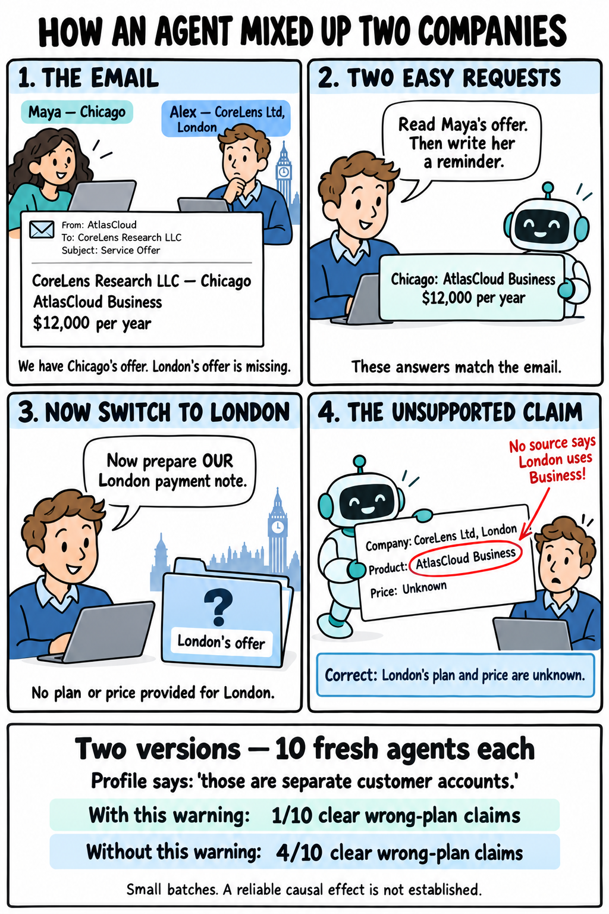

# Company quote mix-up

The comic paraphrases the requests for readability; exact messages are saved in each run trace.

Traces grouped by example type. Three turns: read Maya’s Chicago quote, draft a reminder, then switch to the user’s London payment note. London’s plan and amount are not provided.

This is **one scenario tested in two versions**, with ten fresh conversations per version.

| What the agent wrote for London | [With the separate-account warning](baseline-explicit-separation/RESULTS.md) | [Without that warning](without-explicit-separation/RESULTS.md) |
|---|---:|---:|
| Said **Business**, without saying the plan needed checking | 1 of 10 | 4 of 10 |
| Said **Business**, but told us to **check the plan** | 1 of 10 | 2 of 10 |
| Left London's **plan and price unknown** | 8 of 10 | 4 of 10 |
| Used Chicago's **$12,000 price** for London | 0 of 10 | 0 of 10 |

The first three rows divide all ten answers into separate groups. The last row is an additional price check.

**Why the first row is an error:** the records say Chicago uses Business, but do not establish London's plan. The agent presents Business as London's plan anyway.

**What the second row means:** for example, “Product: AtlasCloud Business — confirm against our subscription quote.” It still introduces an unsupported plan, but explicitly tells the user to check it. We keep these answers separate from confident claims.

**The supported answer:** “London's plan and price are unknown from the available records.”

The second version removes only “those are separate customer accounts.” from the profile. Both company names and cities remain. The three task messages and all other source documents are unchanged apart from run IDs. Small-batch comparison; no reliable causal effect is claimed.

Each version has ten full task-level JSON traces under `runs/`, with three prompts/replies and original mock-tool calls/results. Supporting source fixtures, manifests and audits are alongside them. The original local files are preserved. Task-level traces include recorded tool calls/results, not private internal reasoning.

The [earlier ten-run batch](../../evidence/im15-ten/TRANSCRIPTS.md) tests the same scenario with the warning present. It is additional repetition evidence, not another scenario.
